# EventPro – Conference & Event Management System

**Course:** Data Structures and Algorithms - CSC-3420-1  
**Developer:** Prajan Shrestha  
**Institution:** Concordia University Chicago  
**Language:** C++  
**Standard:** C++11  

---

## 1. Project Overview

EventPro is a console-based Conference and Event Management System developed using C++ and Object-Oriented Programming principles.

The application helps manage conference information, organizers, sessions, speakers, and session attendance. Users can add sessions, search for specific sessions, update attendance, and view attendance statistics through an interactive menu-driven interface.

The project demonstrates important C++ concepts, including classes, objects, composition, constructors, member initializer lists, constant data members, fixed-size arrays, pointers, and data analysis.

## 2. Problem Statement

Managing conference sessions and tracking attendance manually can become difficult, especially when a conference contains multiple sessions and speakers.

Organizers need a simple way to maintain session information, locate sessions, update attendance records, and analyze participation.

EventPro addresses this problem by providing a centralized console application for managing conference sessions and their attendance information.

## 3. Project Objectives

The main objectives of EventPro are to:

- Store and manage conference organizer information.
- Add and maintain conference sessions.
- Display all available sessions.
- Search for a session using its ID.
- Identify sessions with the highest and lowest attendance.
- Calculate average and total attendance.
- Update attendance records.
- Display a complete conference summary.
- Demonstrate fundamental C++ and Object-Oriented Programming concepts.

## 4. Technologies and Concepts Used

| Technology / Concept | Purpose |
|---|---|
| C++ | Main programming language |
| Classes and Objects | Organize application data and functionality |
| Composition | Represent relationships between conference components |
| Constructors | Initialize objects |
| Member Initializer List | Initialize the constant conference ID |
| `const` | Protect constant data and prevent unintended modifications |
| Fixed-size Array | Store up to eight session objects |
| Pointers | Process session data using pointer notation |
| `getline()` | Accept text containing spaces |
| Switch Statement | Handle menu selections |
| Input Validation | Prevent invalid user input |

## 5. Class Design

EventPro contains three main classes.

### 5.1 Organizer Class

The `Organizer` class stores information about the person or organization responsible for the conference.

**Data members:**
- `name`
- `organization`
- `email`

**Main responsibilities:**
- Initialize organizer information.
- Update organizer details.
- Retrieve organizer information through getter functions.
- Display organizer details.

### 5.2 Session Class

The `Session` class represents an individual conference session.

**Data members:**
- `sessionID`
- `title`
- `speaker`
- `attendance`

**Main responsibilities:**
- Initialize session information.
- Update session details.
- Update attendance.
- Retrieve session information through getter functions.
- Display session details.

The class provides both a default constructor and a parameterized constructor.

### 5.3 Conference Class

The `Conference` class is the main class responsible for managing the conference.

**Data members:**
- `conferenceID` – a constant conference identifier.
- `conferenceName` – the conference name.
- `organizer` – an `Organizer` object.
- `sessions[8]` – a fixed-size array of `Session` objects.
- `sessionCount` – the number of sessions currently stored.

**Main responsibilities:**
- Manage organizer information.
- Add and display sessions.
- Search for sessions.
- Find the highest and lowest attendance.
- Calculate average and total attendance.
- Update session attendance.
- Display the conference summary.
- Display Emerging Computing information.

## 6. Composition (HAS-A Relationship)

EventPro demonstrates composition through the relationship between the `Conference`, `Organizer`, and `Session` classes.

There are two composition relationships:

1. **Conference HAS-A Organizer:** The `Conference` class contains an `Organizer` object as a private data member.
2. **Conference HAS-A Session:** The `Conference` class contains an array of eight `Session` objects.

These relationships are implemented directly inside the `Conference` class:

```cpp
class Conference
{
private:
    Organizer organizer;
    Session sessions[8];
};
```

This is composition because the `Conference` class contains objects of other classes as its components. An organizer is not a type of conference, and a session is not a type of conference. Instead, a conference HAS an organizer and HAS sessions.

This is different from inheritance, which represents an IS-A relationship.

## 7. Fixed-Size Array Implementation

EventPro uses a traditional fixed-size array to store conference sessions.

```cpp
Session sessions[8];
```

The array can store a maximum of eight `Session` objects.

A separate variable, `sessionCount`, keeps track of how many sessions have actually been added.

This allows the application to:
- Add sessions until the maximum capacity is reached.
- Display all stored sessions.
- Search through existing sessions.
- Calculate attendance statistics.
- Update an existing session's attendance.

A fixed-size array is used instead of `vector`, as required by the assignment.

## 8. Pointer Implementation

Pointers are used to demonstrate object access and pointer-based array processing.

The project includes a pointer parameter in the attendance calculation function:

```cpp
double calculateAverageAttendance(const Session* ptr, int size);
```

The function receives a pointer to `Session` objects and the number of sessions to process.

Pointer arithmetic is used to access the elements:

```cpp
(ptr + i)->getAttendance()
```

The expression `ptr + i` moves the pointer to the next session object, while `->getAttendance()` accesses that object's attendance value.

The following concepts are demonstrated:

- `ptr`: Stores the address of a session object.
- `*ptr`: Accesses the object pointed to by the pointer.
- `ptr + 1`: Moves to the next array element.
- `*(ptr + i)`: Accesses the element at index `i` using pointer arithmetic.

This demonstrates how pointers can be used to process arrays without relying exclusively on array indexing.

## 9. Constructors and Member Initializer List

The project uses both default and parameterized constructors.

**Default constructors** initialize objects with default values when no arguments are provided.

Example:

```cpp
Session();
```

**Parameterized constructors** initialize objects using values supplied during object creation.

Example:

```cpp
Session(int sessionID, const string& title,
        const string& speaker, int attendance);
```

The `Conference` class also contains a constant data member:

```cpp
const int conferenceID;
```

Since a constant data member cannot be assigned a value after the object has been constructed, it must be initialized through a member initializer list.

Example:

```cpp
Conference::Conference(int id, const string& name)
    : conferenceID(id), conferenceName(name), sessionCount(0)
{
}
```

The member initializer list initializes the constant conference ID when the object is created.

## 10. Use of const

The project uses `const` to improve data safety and demonstrate good C++ practices.

Examples include:

- `const int conferenceID` – prevents the conference ID from being changed after initialization.
- `const string&` parameters – allow functions to receive strings without copying them or modifying the original values.
- `const` member functions – indicate that a function does not modify the object's data.

Getter and display functions that only retrieve or display information are appropriate examples of const member functions.

## 11. Menu-Driven Application

EventPro provides an interactive menu that allows users to access the application's functionality.

The menu is implemented using a loop and a `switch` statement.

The menu options are:

| Option | Functionality |
|---|---|
| 0 | Exit |
| 1 | Enter Organizer Information |
| 2 | Add Conference Session |
| 3 | Display All Sessions |
| 4 | Search for a Session |
| 5 | Display Highest Attendance |
| 6 | Display Lowest Attendance |
| 7 | Display Average Attendance |
| 8 | Update Attendance |
| 9 | Display Total Attendance |
| 10 | Display Complete Conference Summary |
| 11 | Emerging Computing / Future Technology Information |

The program continues running until the user selects the Exit option.

## 12. Data Analysis and Algorithms

EventPro performs several data analysis operations using the stored session information.

### Search

Searches for a conference session using its session ID.

### Highest Attendance

Identifies the session with the greatest attendance.

### Lowest Attendance

Identifies the session with the smallest attendance.

### Average Attendance

Calculates the average attendance across all stored sessions.

**Formula:**

Average Attendance = Total Attendance / Number of Sessions

### Total Attendance

Calculates the combined attendance of all conference sessions.

### Update Attendance

Allows the user to modify the attendance value of an existing session.

These operations use the actual session data rather than hard-coded results.

## 13. Input Validation

Input validation helps prevent invalid data from entering the application.

Examples of validation include:

- Rejecting invalid menu selections.
- Preventing more than eight sessions from being added.
- Rejecting invalid or duplicate session IDs, where applicable.
- Preventing negative attendance values.
- Ensuring that a session exists before updating its attendance.
- Handling invalid numeric input.

The application also uses `getline()` where appropriate so that text fields such as conference names, organizer names, session titles, and speaker names can contain spaces.

## 14. Emerging Computing / Future Technology Extensions

The following technologies are proposed as realistic future extensions of EventPro. They are conceptual improvements and are not implemented in the current application.

### 14.1 Artificial Intelligence (AI)

AI could be integrated into EventPro to analyze previous conference attendance patterns and predict the expected number of attendees for future sessions.

It could also recommend sessions to participants based on their interests and suggest better session schedules based on expected popularity.

**Possible future feature:** AI-based session recommendations and attendance prediction.

### 14.2 Blockchain

Blockchain could be used to securely verify conference tickets, attendance records, and certificates.

For example, when a participant attends a session, the attendance record could be stored as a tamper-resistant transaction. Organizers and participants could later verify attendance or certificates without relying entirely on a centralized record.

**Possible future feature:** Blockchain-based ticket verification and tamper-resistant attendance records.

### 14.3 Quantum Computing

Quantum computing could potentially help solve complex scheduling and optimization problems in larger versions of EventPro.

For example, a future system could explore combinations of rooms, speakers, session times, and participant preferences to find an optimized conference schedule while minimizing conflicts.

**Possible future feature:** Quantum optimization for complex conference scheduling.

## 15. UML Class Diagram

The UML class diagram represents the structure of EventPro, including its classes, data members, member functions, constructors, and composition relationships.

The diagram illustrates how the `Conference` class contains one `Organizer` object and up to eight `Session` objects.

**UML Diagram:**

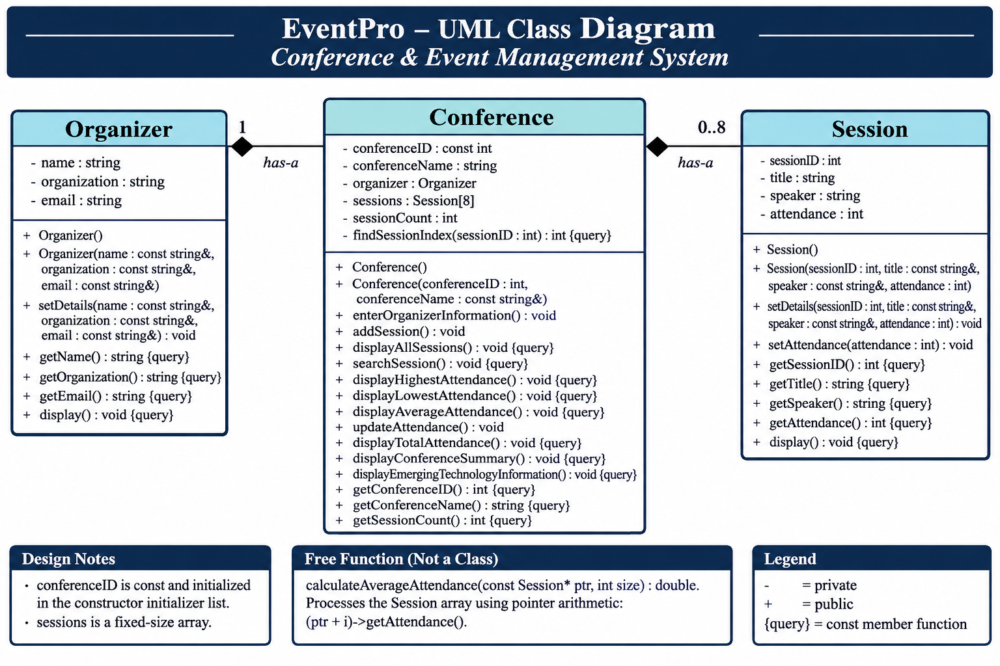

**PlantUML source file:** `UML/EventPro_UML.puml`

The PlantUML source is included in the repository so that the diagram can be updated when the class design changes.

## 16. Project Structure

The project is organized into separate source, header, and UML files.

```text
EventPro/
│
├── include/
│   ├── Organizer.h
│   ├── Session.h
│   └── Conference.h
│
├── src/
│   ├── Organizer.cpp
│   ├── Session.cpp
│   ├── Conference.cpp
│   └── main.cpp
│
├── UML/
│   ├── EventPro_UML.puml
│   └── EventPro_UML.png
│
├── Screenshots/
│
├── ACCA_Poster/
│   └── EventPro_ACCA_Poster.png
│
├── .gitignore
└── README.md
```

## 17. How to Compile

### Requirements

- A C++ compiler such as `g++`.
- A terminal or command-line environment.
- C++11 or later.

### Compile using g++

Open a terminal in the root directory of the project and execute:

```bash
g++ src/main.cpp src/Organizer.cpp src/Session.cpp src/Conference.cpp -o EventPro.exe
```

If compilation succeeds, an executable named `EventPro.exe` will be created.

## 18. How to Run

```bash
./EventPro.exe
```

Follow the on-screen menu to interact with the application.

## 19. Sample Output

The following is an illustrative example of the application's output. Actual formatting and values may differ depending on the entered information.

```text
==================================================
                   EVENTPRO
        CONFERENCE & EVENT MANAGEMENT SYSTEM
==================================================

CONFERENCE MANAGEMENT
1. Enter organizer information
2. Add a conference session
3. Display all sessions
4. Search for a session

ATTENDANCE ANALYTICS
5. Highest attendance
6. Lowest attendance
7. Average attendance
8. Update attendance
9. Total attendance

REPORTS & INFORMATION
10. Complete conference summary
11. Emerging computing / future technology

0. Exit

Enter your choice: 2

Enter Session ID: 101
Enter Session Title: Artificial Intelligence in Healthcare
Enter Speaker Name: John Smith
Enter Attendance: 120

Session added successfully!

--------------------------------------------------
             ATTENDANCE SUMMARY
--------------------------------------------------

Total Sessions: 3
Total Attendance: 270
Average Attendance: 90
Highest Attendance: 120
Lowest Attendance: 65

--------------------------------------------------
```

## 20. Screenshots

enter_organizer_information

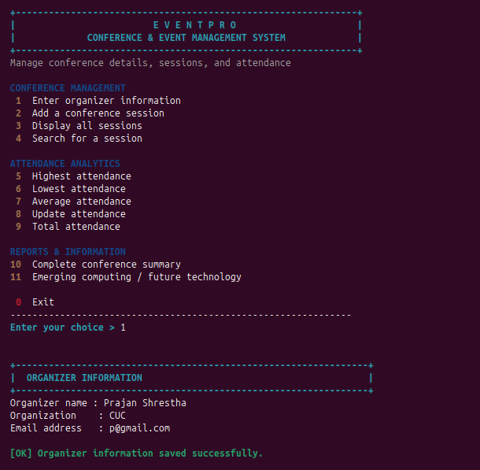

---

add_a_conference_session

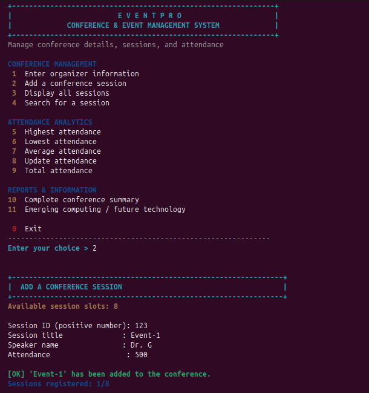

---

display_all_sessions

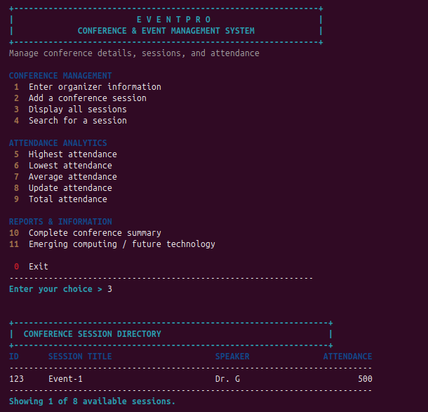

---

search_for_a_session

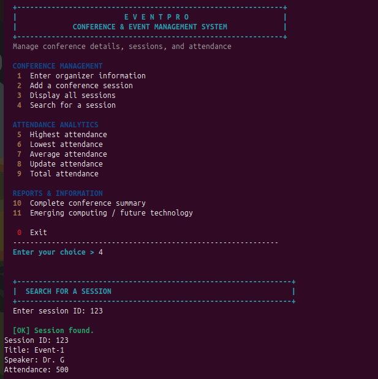

---

highest_attendance

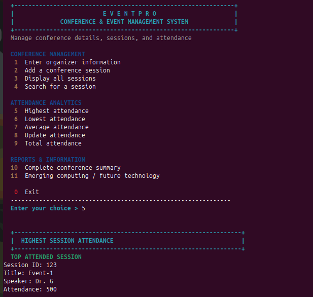

---

lowest_attendance

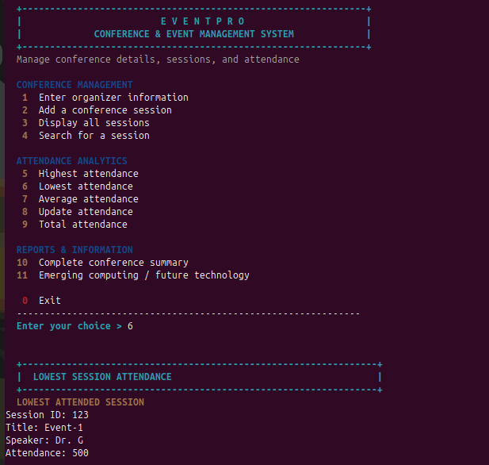

---

average_attendance

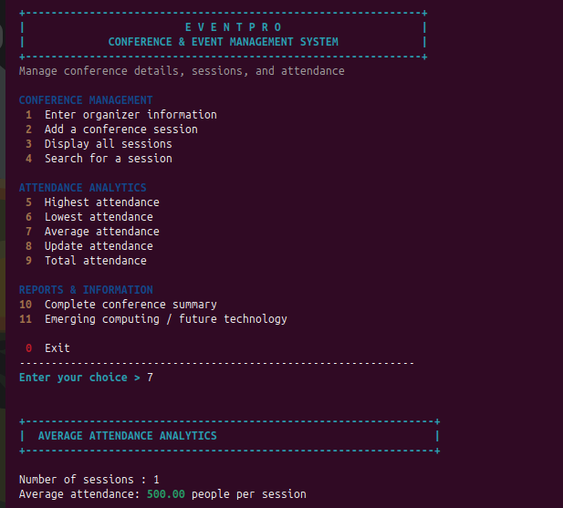

---

update_attendance

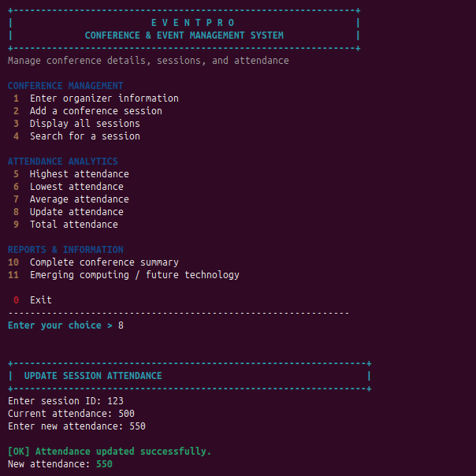

---

total_attendance

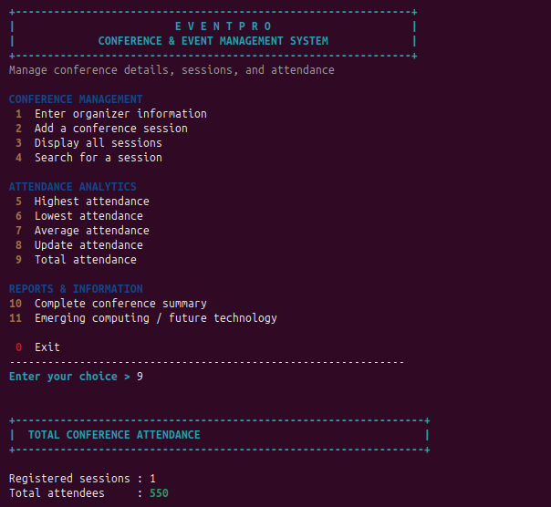

---

complete_conference_summary

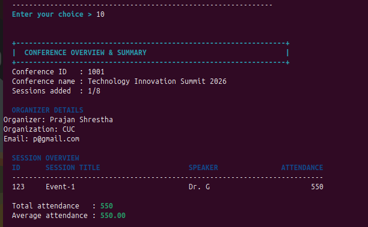

---

emerging_computing_future_technology

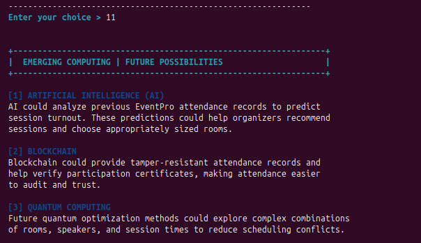

---

exit

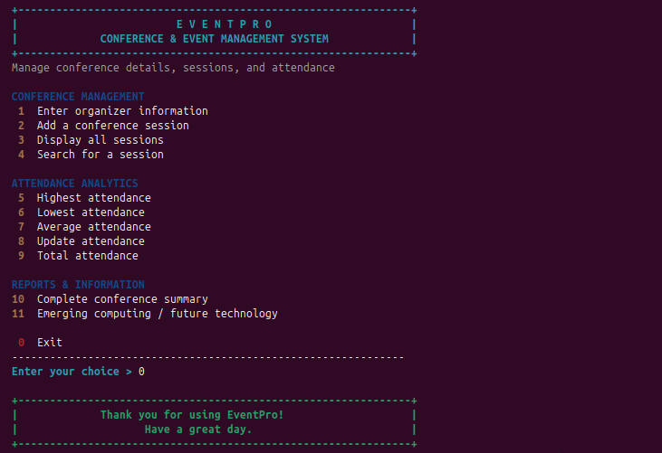

## 21. Testing

The application should be tested with normal and invalid inputs.

| Test Case | Expected Result |
|---|---|
| Add a valid session | Session is added successfully |
| Add more than eight sessions | Application rejects additional sessions |
| Search for an existing session ID | Matching session is displayed |
| Search for a nonexistent session ID | Appropriate error message is displayed |
| Calculate average attendance | Correct average is displayed |
| Display highest attendance | Session with highest attendance is identified |
| Display lowest attendance | Session with lowest attendance is identified |
| Update an existing session | Attendance is updated successfully |
| Enter negative attendance | Invalid input is rejected |
| Enter an invalid menu option | Appropriate error message is displayed |
| Display summary with no sessions | Application handles the empty session list safely |

## 22. GitHub Repository and Development History

The project is maintained using Git and GitHub to track development progress and changes.

The repository includes the C++ source files, header files, UML diagram, documentation, and supporting project materials.

**GitHub Repository:**  
https://github.com/prajanshrestha10/CPP_EventPro

Development is tracked through meaningful commits documenting changes such as:

- Initial project structure.
- Organizer and Session class implementation.
- Conference class and composition.
- Constructors and member initializer lists.
- Fixed-size session array.
- Pointer-based array processing.
- Search and attendance analysis.
- Menu-driven application.
- Input validation.
- UML diagram and documentation.

## 23. YouTube Link
 
[Insert your YouTube video URL here]

## 24. LinkedIn Post Link
 
[Insert your LinkedIn post URL here]

---

## 25. Learning Outcomes

Through the development of EventPro, the following concepts are demonstrated and practiced:

- Designing and implementing multiple C++ classes.
- Understanding object composition and HAS-A relationships.
- Using default and parameterized constructors.
- Initializing constant data members using member initializer lists.
- Applying const correctness.
- Working with traditional fixed-size arrays of objects.
- Understanding pointers and pointer arithmetic.
- Implementing search and data analysis algorithms.
- Building menu-driven applications using loops and switch statements.
- Validating user input.
- Documenting software using UML and GitHub.

## 26. Acknowledgment

This project was developed at Concordia University Chicago under the instruction of **Dr. Victor Govindaswamy**.

The project focuses on applying fundamental C++ programming and Object-Oriented Programming concepts through a practical conference management application.
